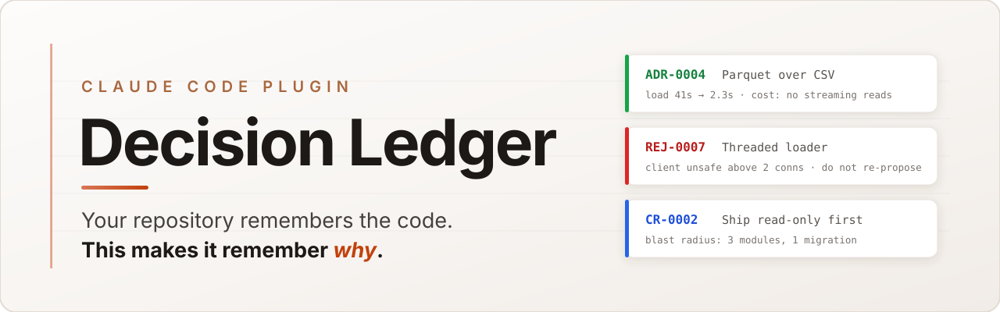
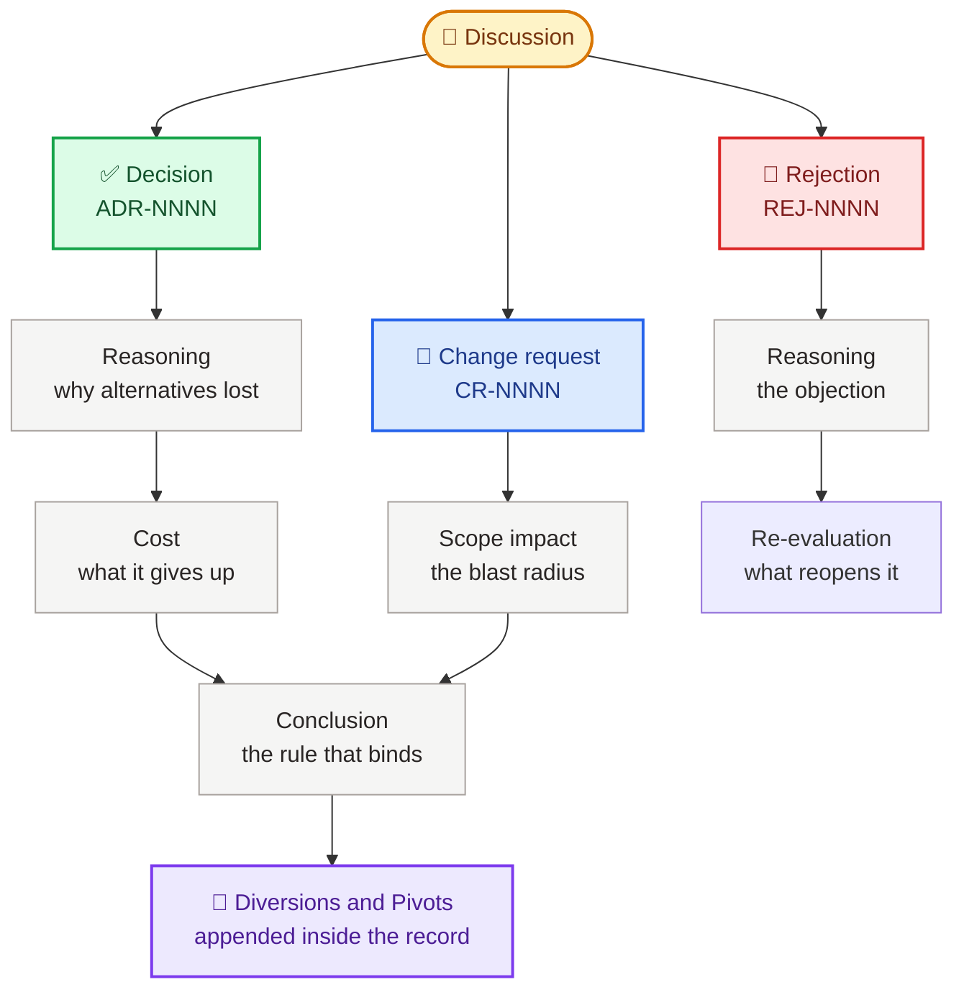

<div align="center">

<picture>
  <source media="(prefers-color-scheme: dark)" srcset="docs/assets/banner-dark.svg">
  <source media="(prefers-color-scheme: light)" srcset="docs/assets/banner-light.svg">
  
</picture>

<br>

[](https://claude.com/claude-code)
[](https://www.python.org/)
[](#requirements)
[](#tests)
[](docs/corpus-survey.md)
[](LICENSE)

<br>

**Every decision, every rejected idea, every change of scope, every mid-flight pivot —**
**written into the repository as numbered, append-only files, by hooks that fire**
**whether or not the agent remembers to.**

[**Install in 60 seconds**](#install-in-60-seconds) · [**What it is**](#what-this-is) ·
[**Which skill do I start with?**](#which-skill-do-i-start-with) ·
[**What is in the box**](#what-is-in-the-box) · [**Why 82 projects**](#designed-against-real-projects-not-intuition)

</div>

---

## What this is

**Decision Ledger is a Claude Code plugin that gives a software project a
memory of its own reasoning.**

Your repository already records *what* the code does — that is what code is.
What it does not record is the thinking: the option you weighed and rejected,
the constraint you discovered at 2am, the scope that changed in week three and
why, the approach you tried for a fortnight and threw away. That lives in a
conversation, and conversations end. A Claude session is compacted, a teammate
leaves, you yourself forget by March.

This plugin writes that layer into the repo, next to the code, in a form both
people and agents read:

<table>
<tr><td width="30%"><b>📌 &nbsp;It captures</b></td><td>Decisions, rejections, change requests, and mid-flight pivots — each with the reasoning, the <b>cost accepted</b>, and the <b>trigger that would reverse it</b></td></tr>
<tr><td><b>⚙️ &nbsp;It enforces</b></td><td>Five hooks that notice unrecorded changes, rescue reasoning before compaction discards it, and brief every new session — so capture does not depend on anyone remembering</td></tr>
<tr><td><b>🧊 &nbsp;It delivers</b></td><td>A genuine cold start: a new teammate, or a Claude account that has never seen this project, reads one directory and is current</td></tr>
<tr><td><b>🤝 &nbsp;It adapts</b></td><td>Projects that already keep a <code>CHANGELOG</code>, <code>STATUS</code> or <code>docs/adr/</code> are <b>adopted</b>, never duplicated or reformatted. Projects with months of commits and no notes are <b>reconstructed</b> from history</td></tr>
</table>

**Use it if** you work with AI coding agents across long-running projects, hand
projects between people, keep ADRs and watch them go stale, or have ever
re-litigated a decision nobody could remember making.

**You do not have to run it.** Day to day the hooks do the work: you write code,
and when a decision appears the agent records it. The commands exist for the
moments that need them — picking up a project you have forgotten, or wrapping up
before you stop for the day.

---

## Install in 60 seconds

### 🤖 Have an AI agent do it

Copy one of the blocks below and paste it to Claude Code — or any coding agent
that can run shell commands. It will install and configure everything,
including working out which of the three situations your project is in.

> The blocks are written in **your** voice, as instructions you are giving your
> agent. Paste one as it is; "my projects" means yours.

**1 — this project only.** Copy and paste:

```text
Install the Decision Ledger plugin into this project.

Repo:         https://github.com/swashbuckler999/decision-ledger
Instructions: https://github.com/swashbuckler999/decision-ledger/blob/main/docs/AGENT-INSTALL.md

Read that AGENT-INSTALL.md first and follow it exactly, in order. It is written
for you: every step has an exact command and a check that proves it worked.
Install at project scope. Stop and tell me if a check fails.
```

**2 — every project on this machine.** Copy and paste:

```text
Install the Decision Ledger plugin account-wide, for all my projects.

Repo:         https://github.com/swashbuckler999/decision-ledger
Instructions: https://github.com/swashbuckler999/decision-ledger/blob/main/docs/AGENT-INSTALL.md

Read that AGENT-INSTALL.md first and follow it exactly, in order. Install at
user scope, then opt THIS project in and leave my other projects alone — I will
opt each one in myself. Stop and tell me if a check fails.
```

That page is deterministic on purpose — preconditions, exact commands,
verification after each step, and a troubleshooting table — so an agent can
complete the install without guessing. Read it yourself:
**[docs/AGENT-INSTALL.md](docs/AGENT-INSTALL.md)**.

### 👤 Do it yourself

**1 · Add the marketplace**

```powershell
claude plugin marketplace add swashbuckler999/decision-ledger
```

**2 · Install it** — pick one scope

*This project only:*

```powershell
claude plugin install decision-ledger@sayan-skills --scope project
```

*Or every project on this machine:*

```powershell
claude plugin install decision-ledger@sayan-skills --scope user
```

**3 · Opt the project in** — *a project-scope install already did this.* The
next session creates the ledger and says so. You only run this yourself after
a `--scope user` install, where each project opts in on its own:

```powershell
mkdir docs\project-memory\decisions, docs\project-memory\rejections, docs\project-memory\change-requests
```

<sub>bash / zsh: <code>mkdir -p docs/project-memory/{decisions,rejections,change-requests}</code></sub>

<sub>A project that has not opted in is told so once, rather than looking
broken. And if your project already keeps its own notes, nothing is created
beside them — see step 4.</sub>

**4 · Ask which situation your project is in**

```powershell
python "<plugin>\scripts\scan_project.py" --propose .
```

<sub>Those commands live in the plugin, not in your project. Replace
`<plugin>` with the installed plugin directory — the path
`claude plugin details decision-ledger` reports, typically
`~/.claude/plugins/cache/sayan-skills/decision-ledger/<version>`. A bare
`scripts\...` path will not resolve from inside your own repository.</sub>

That last one writes nothing. It prints what the project already has and which
skill to start with — nothing at all, `/ledger-backfill`, or `/ledger-adopt`.
See [Which skill do I start with?](#which-skill-do-i-start-with)

> [!TIP]
> **About account-wide (`--scope user`).** It makes the plugin *available*
> everywhere; it does not switch it on everywhere. Each project still opts in
> with the one `mkdir` in step 3, and until then the hooks are completely
> silent. There is deliberately no way to opt every repository in at once — a
> plugin that creates directories in projects you did not ask about is a plugin
> uninstalled in week one.
>
> The cost of choosing it: an inert hook still starts a Python interpreter,
> roughly 106 ms per prompt and 129 ms per turn end, in **every** repository
> you open, including ones that will never use the ledger. Full trade-offs in
> [docs/INSTALL.md](docs/INSTALL.md).

---

## The problem

Six weeks after a decision, the code shows **what** you chose. Nothing shows what
you turned down, or why. So the next person — or the next Claude session, with
none of the conversation — proposes the idea you already tried, and loses a week
rediscovering a paragraph.

<table>
<tr>
<th align="left" width="50%">❌ &nbsp;Without a ledger</th>
<th align="left" width="50%">✅ &nbsp;With one</th>
</tr>
<tr valign="top">
<td>

> *"Let's move the loader to threads — it'd be faster."*

Reasonable. Also tried in March, reverted in April, because the broker's client
library is not thread-safe above two connections.

Nobody is left who remembers. The commit that reverted it says
`revert threading`.

**Cost: a week, and the same two corrupted fills.**

</td>
<td>

> *"Let's move the loader to threads."*

The session already opened with the settled rejections in context:

**REJ-0007** · Threaded loader — *client is not thread-safe above two
connections; corrupted two fills in April. Revisit only if the vendor ships a
thread-safe client.*

**Cost: one sentence.**

</td>
</tr>
</table>

> [!NOTE]
> **The bar this is built against.** Someone on a different machine, with a
> different account and no memory of the originating conversation, reads
> `docs/project-memory/` and is current in twenty minutes — *including* knowing
> which obvious-looking ideas have already been tried and why they failed.
>
> Documentation that records only the final state fails that bar. The final
> state is the one thing the code already tells you.

---

## The lifecycle it captures



A **diversion is not a new file.** It is an append-only section inside the record
it diverts from, so a change of plan sits beside the reasoning it changed and
neither one wins.

Every record carries the two sections that are almost always missing:

<table>
<tr><td width="34%"><b>Cost</b></td><td>What did this give up? What is now harder?</td></tr>
<tr><td><b>Re-evaluation trigger</b></td><td>What concrete, observable thing would make this the wrong call?</td></tr>
</table>

A decision with no stated cost is a decision nobody argued with. A decision with
no re-evaluation trigger can never be revisited honestly, only overturned.

---

## What it looks like in your repo

```
docs/project-memory/
│
├── 00-PROJECT-STATE.md   ← the entry point · the only mutable file · ≤150 lines
├── INDEX.md                generated map of every record
├── CHANGELOG.md            dated, append-only
├── JOURNEY.md              the narrative — including what was thrown away
├── CONSTRAINTS.md          environment and access rules, append-only
│
├── decisions/            ADR-0001 …   what was chosen, and why
├── rejections/           REJ-0001 …   what was turned down, and why
└── change-requests/      CR-0001  …   what changed, and the blast radius
```

> [!IMPORTANT]
> `00-PROJECT-STATE.md` is the only file that gets rewritten, and **nothing is
> allowed to exist solely inside it.** Everything else is append-only and never
> deleted — a superseded decision keeps its file and gains a pointer to the one
> that replaced it.
>
> That rule is checked, not trusted. `check_state.py` reports any line dropped
> from the state file that exists nowhere else in the ledger, and the Stop hook
> runs it every turn.

---

## Which skill do I start with?

That depends entirely on what the project already has — and you do not have to
guess. A read-only scanner will tell you:

```powershell
python "<plugin>\scripts\scan_project.py" --propose .
```

<table>
<tr>
<th align="left">Your project</th><th align="left">Start with</th><th align="left">Because</th>
</tr>
<tr>
<td>New, or nearly</td>
<td><b>nothing</b> — just work</td>
<td><code>decision-ledger</code> records decisions as they appear</td>
</tr>
<tr>
<td>Months of commits, no notes</td>
<td><b><code>/ledger-backfill</code></b> first</td>
<td>It is not greenfield, and the reasoning is still in the log</td>
</tr>
<tr>
<td>Keeps one big <code>DECISIONS.md</code></td>
<td><b><code>/ledger-backfill</code></b></td>
<td>It is read into records — the author already wrote the reasoning, dates and supersessions</td>
</tr>
<tr>
<td>Already keeps a <code>CHANGELOG</code>, <code>STATUS</code> or <code>docs/adr/</code></td>
<td><b><code>/ledger-adopt</code></b></td>
<td>Fit around what exists; never duplicate it</td>
</tr>
</table>

<details>
<summary><b>📜 &nbsp;A working project that kept no notes → <code>/ledger-backfill</code></b></summary>

<br>

A project with eight months of commits and no notes is **not a new project**, and
treating it as one leaves every decision already made sitting in the commit log
where no future session will look for it.

`mine_history.py` scores the history for evidence — commits that undo earlier
work, that carry written reasoning, that name an environment limit — ranks the
strongest, and caps the list at a sitting's worth of work.

The rule the skill works under is strict:

> **A reconstructed record may never state a reason the evidence does not
> support.**

So every backfilled record carries the commits it came from and whether its
reasoning is `stated`, `inferred` or `unconfirmed`, and is dated to the commit
rather than to today. A confident fabrication is worse than an admitted gap,
because it looks exactly like a witnessed record.

The part no script can do: work you *considered and did not do* leaves no commit
at all. The skill asks you for those directly, and three or four of them are
worth more than everything it reconstructs on its own.

</details>

<details>
<summary><b>🧩 &nbsp;A project that already keeps notes → <code>/ledger-adopt</code></b></summary>

<br>

A read-only scanner finds the `CHANGELOG`, `STATUS`, `DECISIONS` or `docs/adr/`
you already have, works out your changelog's **order** and **entry format** from
the file and its git history, proposes a mapping, and writes `.ledger.json` only
once you approve it. The ledger then appends to your files rather than creating a
parallel set beside them.

It matches what is already there rather than imposing a house style:

| Your project does this | So the ledger does this |
|---|---|
| Newest-first changelog | Inserts at the **top**, not under the oldest heading |
| `## 2026-04-02 — Title` entries | Copies that format exactly |
| `docs/adr/0001-…` (`adr-tools` style) | **Adopts** the folder, continues at the next free number, matches the naming |
| CRLF line endings | Stays CRLF — byte-for-byte everywhere else |

**One thing it will not adopt: your status file.** The briefing is injected into
every session and rewritten as state changes, while a maintained `STATUS.md` is
usually a long append-only log. Pointing one at the other would inject a fragment
of it into every session and invite rewriting a file you never wanted rewritten —
so the briefing is always a new file that *points at* yours.

It never migrates existing content into records
([why](docs/project-memory/rejections/REJ-0006-migrate-existing-docs-into-records.md)),
and nothing here overwrites a file it did not create: `build_index.py` refuses to
touch an `INDEX.md` it did not generate, records are never overwritten, and the
skills append in whatever style is already there rather than reformatting,
reordering or deduplicating.

</details>

---

## What is in the box

### 🧠 &nbsp;Five skills

| | Skill | What it does |
|---|---|---|
| 📝 | **`decision-ledger`** | Writes a record: decision, rejection, change request or pivot |
| 🧭 | **`cold-start`** | Briefs you on a project you have no memory of |
| 🧹 | **`wrap-session`** | Flushes unrecorded reasoning before the context is lost |
| 🧩 | **`ledger-adopt`** | Fits the ledger around a project that already keeps notes |
| 📜 | **`ledger-backfill`** | Reconstructs the ledger for a project that kept none |

### ⚓ &nbsp;Five hooks

Skills carry the protocol. Hooks carry the enforcement, and fire whether or not
the agent remembers to.

| | Hook | What it does |
|---|---|---|
| 🚀 | **`SessionStart`** | Injects the briefing — state, settled rejections, decisions in force, open questions |
| 💾 | **`PreCompact`** | Rescues reasoning before compaction discards it |
| 👣 | **`PostToolUse`** | Keeps a raw activity trail for later reconstruction |
| 🛑 | **`Stop`** | Notices code that changed with nothing recorded |
| 👂 | **`UserPromptSubmit`** | Catches decision-shaped phrasing in your own words |

> [!TIP]
> **`PreCompact` is the one that matters most.** Compaction keeps conclusions and
> discards the argument that produced them — precisely the content this plugin
> exists to keep. The hook writes a checkpoint to disk and tells the summariser
> what to preserve.

The `Stop` hook **reminds; it does not block.** A wall across every turn that
touches a file trains you to uninstall the plugin within a day
([REJ-0004](docs/project-memory/rejections/REJ-0004-blocking-stop-hook-by-default.md)).
Set `LEDGER_STRICT=1` if you want it to block.

---

## Designed against real projects, not intuition

The adoption rules are not guesswork. They were built against a corpus of **82
real projects**, and several of this plugin's own defaults were wrong and were
corrected from that data — see **[docs/corpus-survey.md](docs/corpus-survey.md)**.

| What the corpus showed | What changed |
|---|---|
| 45% of projects already kept notes of some kind | Adoption became a first-class mode, not an afterthought |
| 20 of 26 changelogs were newest-first | The default insert position flipped |
| All 26 used `##` headings, none used bullets | Entry format is copied from the file, never imposed |
| One project's `.git` is a **file**, not a directory | Worktrees and submodules are real environments, and were all handled wrongly |

The same corpus is used as a **test**, not just a reference, and it has earned
that four times over. Twice it showed a filter to be badly wrong *after* it had
passed every hand-written fixture — once for file-role matching, and once for
history mining, where a rule that looked excellent on a fixture flagged **98% of
all real commits.** The third time it exposed a bug hiding behind an empty
result: a code path returning nothing on all 82 projects, indistinguishable from
working. The fourth found the plugin telling every already-installed project to
reconstruct a ledger it already had.

> **A fixture tests the author's model of the world. The corpus tests the world.**

---

## Using it

Mostly you do not. The hooks fire on their own and the agent invokes
`decision-ledger` when a decision appears. These are worth running by hand:

| Command | When |
|---|---|
| `/cold-start` | Picking up a project you do not remember |
| `/wrap-session` | Before you stop for the day |
| `python "<plugin>\scripts\mine_history.py" . --summary` | To see what your history still holds that the ledger does not |
| `python "<plugin>\scripts\check_state.py" --project .` | Lists anything dropped from the state file that exists nowhere else |
| `python "<plugin>\scripts\check_version.py"` | Which version you have, and whether a newer one is on disk |
| `python "<plugin>\scripts\build_index.py" --project .` | After adding records by hand |

---

## Staying up to date

The session briefing tells you — once a week at most — if a newer version is
already on your machine but not in use. It never upgrades anything itself, and
**it makes no network request**: it reads only Claude Code's own plugin cache,
which you refresh when you choose to.

```powershell
claude plugin marketplace update sayan-skills
```

```powershell
claude plugin update decision-ledger@sayan-skills
```

Your ledger lives in your project, not in the plugin, so an upgrade never
touches your records. What changed in each version, and why:
**[docs/RELEASES.md](docs/RELEASES.md)**.

## Requirements

- **Claude Code** 2.1 or later
- **Python** 3.9+ on `PATH` as **`python`** — see the warning below
- **git** — optional; the Stop hook and orphan detection stay quiet without it

> [!NOTE]
> **`python` vs `python3` is handled.** Each hook runs
> `python … || python3 …`, so if `python` is missing — as it is on modern
> macOS and many Linux distributions — the second name is used automatically.
> Nothing to configure.
>
> Two things worth knowing. The order is deliberate: on Windows `python3`
> often resolves to a Microsoft Store stub that does nothing, so `python` is
> tried first and the stub is never reached. And the fallback relies on `||`,
> which the shell running hook commands provides on macOS and Linux (`sh -c`)
> and on Windows under Git Bash. **If you are on Windows without Git Bash,
> hook commands run under PowerShell, and PowerShell 5.1 cannot parse `||`** —
> install Git Bash, upgrade to PowerShell 7, or edit `hooks/hooks.json` in the
> installed plugin and cut each command back to the single `python …` form.

## Tests

```powershell
python tests\test_hooks.py
```

**317 checks**, dependency-free. Each one drives a hook with the JSON payload
Claude Code really sends, or a script against a throwaway repository on disk.
Every bug this project has had keeps a named regression test — the
untracked-directory bug it shipped with, the changelog write that silently
converted CRLF to LF, the worktree blindness that made it call a real repository
unversioned, and the index that overwrote a hand-written file.

```powershell
python tests\simulate_session.py
```

**23 more checks, across twelve turns of a replayed session** — a cold start, a
decision-shaped prompt, an edit, an ending with nothing recorded, the record
being written, compaction, a resume, a line dropped from the briefing. Needs no
model and no API key, and takes `--plugin-root` to run against an installed
copy instead of the source tree.

> [!NOTE]
> The sequence is the point. The hooks form a state machine — what the Stop
> gate says depends on what happened three turns earlier — and on its first
> run this replay found a defect all 231 unit tests had missed: in a freshly
> installed project, the very first "you changed code and recorded nothing"
> reminder never fired. A unit test builds the state it imagines; a replay
> builds the state a session actually produces.

---

## This repository uses its own plugin

The records under `docs/project-memory/` are not examples. They are the real
design history of the thing you are reading about — including the ideas that were
built and thrown away.

**Read in this order:**

| | File | What it gives you |
|---|---|---|
| 1 | **[00-PROJECT-STATE.md](docs/project-memory/00-PROJECT-STATE.md)** | Where this project stands right now |
| 2 | **[INDEX.md](docs/project-memory/INDEX.md)** | The map of every decision, rejection and change request |
| 3 | **[JOURNEY.md](docs/project-memory/JOURNEY.md)** | The narrative — every route abandoned, and why |
| 4 | **[INSTALL.md](docs/INSTALL.md)** | Getting it into your own project |

### Current status

> **v0.1.1 — early, and specific about why.**
>
> **Covered:** 352 unit checks and a 23-check session replay. Read-only passes
> over 82 real projects. The write path run against copies of three real
> projects, with the originals proved byte-identical. Four live sessions, in
> which all five hooks were observed firing and all five skills invoked —
> including `wrap-session` finding an unrecorded decision on its own, which is
> the central claim working unprompted.
>
> **Not covered:** sustained use by anyone other than its author. Every one of
> those four sessions found defects, and the rate has not reached zero. The
> first found that no script the skills call was reachable outside the
> development checkout; the fourth found two correct fixes colliding to
> produce a false "nothing was recorded" message. Early ones were in the code,
> later ones in the instructions, and the most recent in the join between
> them.
>
> **What that means for your data:** the defects that could have cost you
> something — a changelog rewritten with the wrong line endings, a
> hand-written index overwritten, an entry dropped under concurrent writes —
> were found earlier and each has a named regression test. The ones found
> most recently produce a wrong message rather than a wrong file. That is a
> trend, not a guarantee.

---

<div align="center">

**MIT** · [LICENSE](LICENSE) · built by [Sayan Majumder](https://github.com/swashbuckler999)

<br>

### *If it is not written down, it is lost.*

</div>
